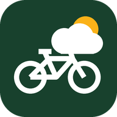

# GPX Weather

**Plan the weather for your bike tour, day by day.**

👉 **Open the app: https://leonvolles.github.io/GPXweather/**

GPX Weather is a free web app for multi-day bike tours. You load the GPX file of
your route, choose how many kilometres you want to ride per day, and the app
splits the route into daily stages. For every stage you see what the weather
will be like on the road – at the time you will actually be there – plus
distance, climbing and how much head- or tailwind to expect.

The forecast comes from several weather models at once (ECMWF, ICON, GFS,
Météo-France). The app shows whether they agree, so you know how reliable the
forecast is.

No account, no sign-up, no ads. Your tours stay on your phone.

## What you get for every stage

- 📏 Distance, climb and descent, an elevation profile and the riding time
- 🌡️ Temperature while riding, how cold it feels, and the night low at the
  destination (useful when camping)
- 🌧️ Rain amount and rain probability while you ride
- 🌬️ Wind speed and direction, gusts, and **head- or tailwind in your direction
  of travel**
- 🌅 Sunrise and sunset, with a warning if you would arrive after dark
- ✅ Whether the weather models agree or disagree
- ⬇️ The GPX of just that stage, to load into your navigation app
- ⛺ Campsites around the end of the stage, listed and marked on the map

You also get a map of the whole tour (bike map by CyclOSM), an elevation profile,
an overview table of all stages, and the whole forecast as a PDF.

## Install it on your iPhone

1. Open **https://leonvolles.github.io/GPXweather/** in **Safari**.
2. Tap the **Share** button (the square with the arrow).
3. Choose **Add to Home Screen**, then **Add**.

"GPX Weather" now sits on your home screen like a normal app. It opens full
screen and also starts without a connection, showing the last weather it
loaded.

> Always use the app from the home screen. The home-screen app and a Safari tab
> keep their tours separately.

**On Android:** open the link in Chrome, tap the **⋮** menu → **Add to Home
screen** (or **Install app**).

**On a computer:** just open the link in any browser.

## How to use it

### 1. Load or plan your tour

**Plan it right in the app:** tap **🧭** to open the route planner. Tap the map
for start, via points and destination – the route is calculated by
[BRouter](https://brouter.de/brouter-web/) on OpenStreetMap data. Choose a
profile (trekking bike, fast bike, safety first, shortest) and – for trekking –
options like 🚗 avoid main roads, 🚲 cycle routes only, ⛴️ no ferries or 🤫 quiet
roads. Drag points to adjust, then tap **✓ Use as tour**. **📲 GPX** saves the
route (e.g. for Bergfex Touren), **🌐 BRouter-Web** opens the same points and
profile in BRouter's full planner – export the GPX there and load it with 📂.
(BRouter-Web can't take your speed or weight from a link; GPX Weather's own
riding-time model is used for all times anyway.) Routes planned with BRouter bring their
road surfaces along, so the riding-time model knows them right away.

**Or load a GPX file:** get the GPX of your route, for example from Komoot,
Strava, Ride with GPS, Garmin or a tour website. On the iPhone, save it to the **Files** app first
(*Share → Save to Files*).

In GPX Weather tap **＋ GPX** and pick the file. The route, map and stages
appear right away; the weather follows a few seconds later. The tour is saved
on your phone, so you only do this once.

### 2. Set up your days

Open **Settings** and choose:

- **Plan each day by** distance (**km per day**) or by **hours on the road per
  day** – with hours, each stage ends where your time is up, so hilly, gravel
  or headwind days get shorter and easy days longer
- **First stage on** – the day you start (today by default)
- **Daily departure** – when you usually set off
- **Your speed on flat asphalt** (without wind and breaks), your **breaks** in
  % and your **weight** with bike and luggage – the starting point for the
  riding-time estimate (see *How riding times are estimated*)
- **Weather models** – which forecasts to compare

### 3. Update your position on the way

Tap **📍 Update my position** and allow location access. The app finds where
you are on the route and plans only the part still ahead of you. After the
first time, your position is updated automatically whenever you open the app
(you can switch this off in Settings).

You can also tap the route on the map, or move the position slider.

The app keeps a small ride log: the days you have already ridden move into a
collapsed **✓ Completed** list (with date, km, climb and a GPX of each day),
followed by **today** and the stages still to come. Today's stage is planned
from where you set off in the morning, so updating your position during the
ride shows your progress ("40 km ridden · 40 km to go") instead of moving
today's goal.

If you declined location access by mistake: iPhone **Settings → Privacy &
Security → Location Services → Safari Websites → While Using the App**.

### At the end of the day

You have two ways to close a day:

- **🏁 End today here** (on today's card) saves your current position as the
  end of today. The plan then continues tomorrow from there with your daily
  distance. Tapped too early? **Undo** reopens the day.
- **📤 Upload today's ride (GPX)** – load the track you recorded with your
  bike computer, watch or phone app (Garmin, Wahoo, Komoot, Strava …). The app
  finds where the ride lies on your route, ends that day there and adds the
  real numbers to the **✓ Completed** list: time on the road and average speed.
  Your recorded ride is drawn on the map. You can also add earlier days later
  with **📤 Add a ridden day** in the Completed list – the date is taken from
  the GPX.

### Your pace

From your completed days the app learns how far you really ride per day (last
seven riding days). From uploaded rides it also learns how strong you ride and
how long your breaks are – see below. With **Plan with my average from completed
days** switched on in Settings (default), the coming stages, riding times and
the arrival date use this instead of the values you set. "Your pace" in
*What's ahead* shows the numbers.

### How riding times are estimated

The app does not just divide the distance by an average speed. It works out
your speed for every few hundred metres of the route, the way a cycling power
model does:

- **Climbs and descents** from the elevation profile – uphill you get slower
  depending on the gradient and your weight; downhill speed is limited (lower
  on steep descents).
- **Road surface** from OpenStreetMap – asphalt, cobbles, compacted gravel,
  gravel and dirt each have their own rolling resistance and safe top speed.
  The surface share is shown for every stage. It is loaded for the stages ahead
  in the background; until then the road counts as paved.
- **Wind** – the forecast head- or tailwind at the time you pass each part of
  the route. Headwind costs more time than the same tailwind saves.
- **Breaks** are added on top of the riding time.

Every stage shows the result, e.g. *"3:10 h on flat asphalt · climbs +25 min ·
surface +12 min · wind +18 min · breaks +55 min"*.

The model starts from your **speed on flat asphalt** and **breaks** in Settings.
As soon as you upload recorded rides, it calibrates itself: it finds the effort
that reproduces your moving time on exactly those roads, and your real share of
breaks – so a slow day in the hills is not mistaken for being slow in general.

### 4. Read the forecast

The start page only shows what you need for a quick check:

- **Tour progress** – how much of the whole route you have ridden, what is
  left, the number of days to go and the expected arrival.
- **Today's stage** (green box) – 📏 distance, ⏱️ time on the road (🚴 riding +
  ☕ breaks), weather and 💨 wind, your progress today and any warnings. Below
  are four buttons: **📲 To nav app** (opens the share sheet – pick Bergfex
  Touren or your navigation app to load today's GPX), **⛺ Campsites** near
  tonight's stop, **🏁 End day** and **📤 Upload ride**. **More about this stage** opens the
  details: surface, elevation, time estimate, weather and night, campsites and
  the GPX.
- **The map**, zoomed to today's route; switch to **Whole tour** for the
  overview.

Everything else is folded away and opens with a tap: **Upcoming stages** (table
and all day cards), **Completed**, **Weather models compared**, **Elevation
profile** and **Route details**.

- In each stage, tap **Model comparison and hour-by-hour** to see every
  weather model side by side and hourly charts along the route.
- **⬇ GPX of this stage** saves that day's route, or opens it directly in your
  navigation app.

### 5. Find a campsite for the night

At the end of each stage, open **⛺ Campsites near the end of this stage**.
Choose how far you are willing to ride (2 to 30 km) and the app lists the
campsites around the stage end, closest first: how far each is from the stage
end and from your route, and – if known – website, phone and opening hours.
They are also marked ⛺ on the map. **Directions** opens your maps app.

The campsites come from OpenStreetMap, so small or new places may be missing.
Check opening times before you go – many campsites close for the winter.

### 6. Take the forecast with you as a PDF

At the end of the page, tap **📄 Download the whole forecast as PDF**. The PDF
contains the overview of all stages, the elevation profile, the model
comparison and every stage in detail, including the campsites you searched
for. On the iPhone you can save it to Files or send it on.

### Several tours

Every GPX you load is kept. Switch between tours in the list at the top; 🗑
removes the selected tour from your phone.

## Good to know

- **Forecast range:** weather forecasts reach about 16 days ahead (some models
  less). Stages further away show the route and distances, and get weather as
  the date comes closer.
- **Why the models differ:** each weather service calculates the forecast
  differently. If they disagree a lot, the weather is hard to predict – check
  again closer to the day.
- **Gaps in the GPX:** some route files leave out parts, such as a ferry
  crossing. These are drawn as dashed lines and counted as a straight line.
- **Offline:** without a connection the app still opens with your tours and
  the last weather. The map background needs a connection; the route itself is
  always shown.
- **Your data:** your GPX files and tours are stored only on your device and
  are not uploaded anywhere. To get the weather, the app sends only the
  coordinates of points along your route to the weather service.
- **Unused for weeks?** Safari may clear data of websites that were not opened
  for a long time. Tours in the home-screen app are kept.
- This is not an official weather warning service. Always check local warnings
  before heading into the mountains or bad weather.

## Credits

Weather data by [Open-Meteo.com](https://open-meteo.com/) (CC BY 4.0), based on
models from ECMWF, DWD, NOAA, Météo-France and the UK Met Office. Elevation
data: Copernicus DEM via Open-Meteo. Routing: BRouter. Place names: BigDataCloud. Campsites:
OpenStreetMap via the Overpass API. Map:
[CyclOSM](https://www.cyclosm.org/), map data © OpenStreetMap contributors.
